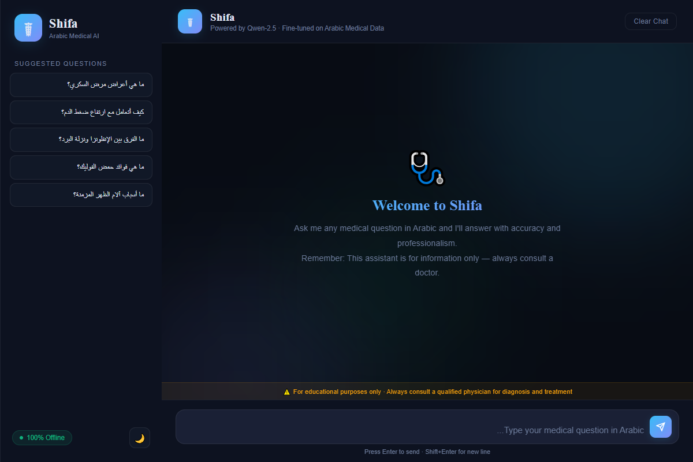
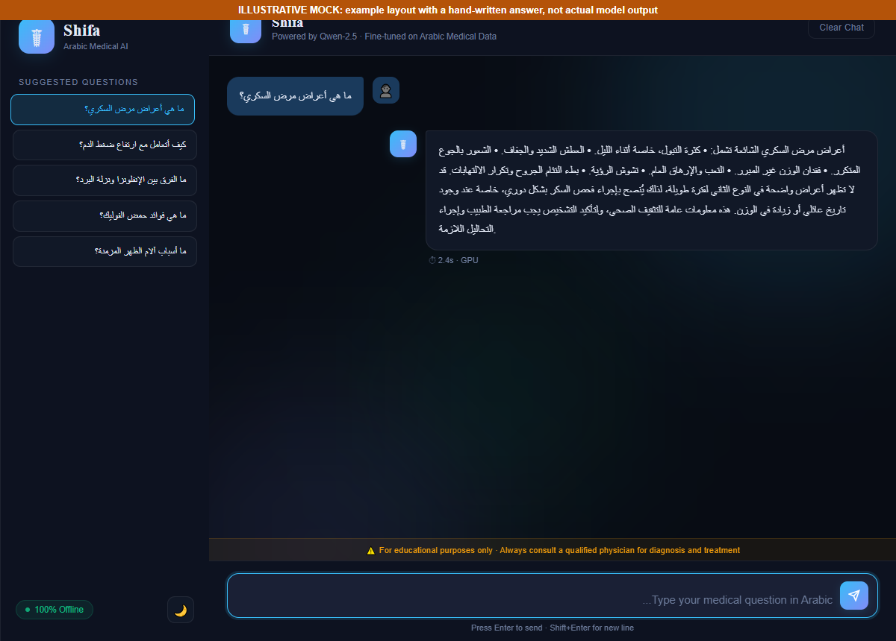
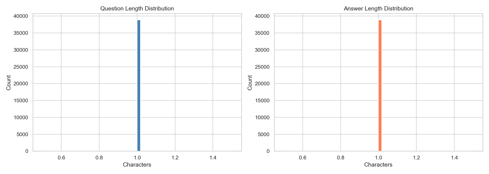

# Medical LLM Finetuning: Arabic Medical Assistant ("Shifa")

An Arabic medical question-answering assistant built on **Qwen2.5-1.5B**, fine-tuned with LoRA on a curated Arabic medical
QA dataset and served with **FastAPI**, with an optional **RAG** layer (FAISS retrieval over the training QA pairs).
It gives general, cautious health information and is designed to avoid diagnoses and drug doses.

Model on the Hub: [hagora-30/qwen2.5-1.5B-medical-arabic](https://huggingface.co/hagora-30/qwen2.5-1.5B-medical-arabic)



*The chat interface (suggested questions, Arabic input, safety banner, dark/light theme). The screenshot shows the
interface only; running the full app downloads the model and needs the dependencies below.*

### Example conversation



*Illustrative mock: the layout of a conversation with a hand-written answer, not the output of the model.*

## Architecture

```
question ─► (RAG) FAISS search: 2 most similar QA pairs ─► prompt = system + reference info + question
         ─► fine-tuned Qwen2.5-1.5B ─► Arabic answer ─► chat UI
```

| Component | Choice |
|---|---|
| Base model | Qwen2.5-1.5B-Instruct, LoRA (r=128, alpha=256) on all attention and MLP projections |
| Training | PyTorch, Transformers, PEFT, TRL (`src/finetune.py`), BF16, 5 epochs, effective batch 32, cosine schedule |
| Retrieval | FAISS index over the QA pairs, embeddings `paraphrase-multilingual-MiniLM-L12-v2` |
| Backend | FastAPI (`app/main.py`), `USE_RAG=0` switches retrieval off |
| Frontend | Plain HTML/CSS/JS in `app/static/` |

## Project structure

```
├── app/
│   ├── main.py                    # FastAPI server (RAG on/off)
│   └── static/                    # index.html, script.js, style.css
├── src/
│   ├── dataset_preprocessing.py   # filter + clean the public dataset -> data/*.jsonl
│   ├── eda.py                     # exploratory analysis (figures in reports/)
│   ├── finetune.py                # LoRA fine-tuning of Qwen2.5-1.5B
│   ├── build_vector_db.py         # build rag_index/ from the QA pairs
│   ├── compare_base_vs_finetuned.py
│   ├── smoke_test.py              # 3-step training run to check the setup
│   └── test_model.py              # sample questions -> reports/test_output.txt
├── experiments/                   # 0.5B and 7B (Unsloth) fine-tuning runs
├── data/                          # qwen_ready_medical_qa.jsonl, sample_preview.json
├── rag_index/                     # index.faiss, index.pkl
├── reports/                       # EDA figures and sample outputs
└── requirements.txt
```

## Dataset

[madilcy/arabic-medical-qa-MERGED-MAQA-MMMLU-MI](https://huggingface.co/datasets/madilcy/arabic-medical-qa-MERGED-MAQA-MMMLU-MI)
cleaned by `src/dataset_preprocessing.py`: URLs, e-mails and signatures removed, whitespace normalized, short pairs dropped,
questions that ask for a personal diagnosis filtered out (only general questions are kept), duplicates removed.
Drive links for the original and cleaned data are in `Dataset_DriveLink.txt`.



## Setup and run

```bash
conda create -n medical_env python=3.11 -y && conda activate medical_env
pip install -r requirements.txt
uvicorn app.main:app --host 127.0.0.1 --port 8000
```

Open `http://127.0.0.1:8000`. The first start downloads the model (and the embedding model when RAG is on).
A CUDA GPU is recommended; 16 GB of RAM is the minimum on CPU. Rebuild the dataset, index or model:

```bash
python -m src.dataset_preprocessing     # data/qwen_ready_medical_qa.jsonl
python -m src.build_vector_db           # rag_index/
python -m src.finetune                  # outputs/qwen-medical (GPU)
```

### API

`POST /api/chat`

```json
{ "message": "ما هي أعراض مرض السكري؟", "max_tokens": 512, "temperature": 0.3 }
```

Response: `response`, `elapsed_seconds`, `device`, `rag`, `disclaimer`. `GET /api/health` reports the model and RAG mode.

## Engineering notes

- **One backend:** a single FastAPI app with RAG on or off (`USE_RAG`), one frontend and one FAISS index.
- **Safety prompt:** RAG and non-RAG modes share the system prompt used in fine-tuning (consult a doctor in critical cases,
  no specific doses), and every response carries a disclaimer field.
- **Evaluation:** the 5% held-out split is evaluated every epoch during fine-tuning.
- **Portable setup:** project-relative paths, optional `flash-attn` (falls back to PyTorch SDPA), local-only CORS.

## Scope

The 1.5B model with retrieval is the recommended configuration; the 0.5B run (`reports/test_output_q0.5B.txt`) is kept as a
smaller baseline. Answers are general health information and should be verified with a physician.

## Disclaimer

The output of this model is for informational and educational purposes only. It is not medical advice, diagnosis or
treatment. Always consult a qualified physician about medical conditions. The developers accept no liability for actions
taken based on the model's output.
